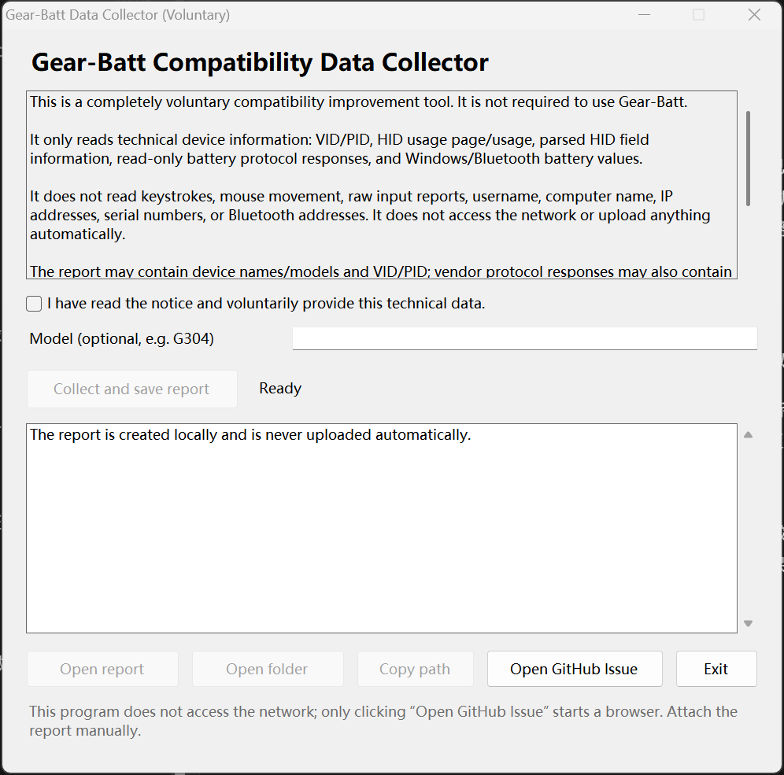
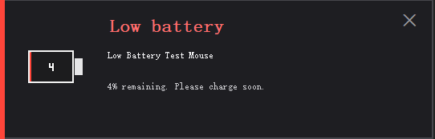

[中文](README.md) | **English**

# Gear-Batt

A minimal Windows tray utility that reads the battery level of wireless peripherals (2.4 GHz receivers / Bluetooth) and shows it in the notification area. While charging it shows a lightning bolt; on battery it fills the icon proportionally and displays the percentage.

> The application UI follows the Windows display language (Chinese/English); use `--lang zh|en` to override. This English README covers installation, usage, privacy, and development.


## Features

- **Single exe, no installation**: uses the built-in .NET Framework 4.8 (included in Windows 10 1903+ / Windows 11); no third-party runtime.
- **Enumerates all readable wireless devices**: v1 displays one selected device at a time; choose it from the menu when multiple devices are present.
- **Battery state**: the battery icon fills proportionally; 0–99% shows percentage digits inside the battery; 100% shows a full battery.
- **Charging state**: a yellow lightning bolt appears inside the battery; the exact percentage is available in the tooltip and menu.
- **Low-battery colors**: ≤15% red, ≤30% orange, ≤55% yellow, otherwise green.
- **Exact information**: tooltip and left-click menu show the device name, percentage, charging/battery state, source, and last update time.
- **Instant refresh**: device attach/remove and system power-status changes trigger a scan immediately; while charging or at ≤10% the app checks every 5 seconds; otherwise every 60 seconds.
- **Low-battery alert**: when the selected device is discharging and below 5%, a silent card appears. It plays no sound, does not steal focus, and does not auto-close (click the × to close). It is shown once per low-battery episode.
- **Remembers selection**: stored in `%LOCALAPPDATA%\Gear-Batt\settings.ini`.
- **Optional autostart**: starts for the current user; respects the disabled state in Task Manager → Startup.
- **No network access in the main app**.
- **UI follows the system language**: the main app and collector follow the Windows display language (Chinese/English); override with `--lang zh|en`.

## UI language

At startup the main app and collector read the Windows display language:

- Chinese Windows: Chinese UI
- Other languages: English UI
- Override: `Gear-Batt.exe --lang zh` or `--lang en`; the collector supports `--lang zh|en` too

## Help adapt your device (voluntary)

`Gear-Batt-Collector.exe` is a separate, optional, voluntary compatibility data collector. It is not required to use Gear-Batt.



1. Double-click `Gear-Batt-Collector.exe`.
2. Read the notice; the collect button is enabled only after checking the voluntary consent box.
3. Optionally enter the device model.
4. Click “Collect and save report” (采集并保存报告).
5. The report is saved to the Desktop as `Gear-Batt-Report-YYYYMMDD-HHMMSS.txt`.
6. Review it, then attach it manually to a [GitHub Issue](https://github.com/dddsx3/Gear-Batt/issues/new).

**Collected**: OS/app version, HID VID/PID, usage page/usage, report lengths, product/manufacturer names, parsed HID value caps, read-only battery protocol responses, and Windows/Bluetooth battery values.

**Not collected**: keystrokes, mouse movement, raw input reports, username, computer name, IP addresses, USB serial numbers, or Bluetooth addresses. The collector does not access the network and does not upload anything automatically. Instance-specific path suffixes are redacted. Device names/models and vendor-specific protocol bytes may be present; review the report before sharing.

The main app menu also has “Help adapt my device…” (帮助适配我的设备…): if the collector is in the same folder as the main exe it launches it; otherwise it shows the project URL and instructions.

## Supported battery sources

1. **Windows battery interface**  
   For 2.4 GHz receivers / wireless peripherals that expose a HID battery device to Windows (some Logitech, Microsoft, Dell, and other brands). Reads capacity and charging state through `IOCTL_BATTERY_QUERY_INFORMATION`.

2. **Logitech HID++ 2.0**  
   For Logitech Unifying / Bolt / Lightspeed receivers and direct HID++ devices. Reads:
   - `0x1000` Battery Status (level/status)
   - `0x1004` Unified Battery (level/approximate level/status)
   - `0x1001` Battery Voltage (estimated percentage, marked as approximate)
   - `0x0005` Device Name

3. **ATK / VXE wireless mice (373B:1216)**  
   Read-only protocol 2 query: usage page `0xFF05`, Report ID `0x08`; sends the query only when VID/PID/usage page/report length match exactly.

4. **DARKRIM wireless headsets (3654:6901)**  
   Read-only Jieli JL_RCSP TLV query: usage page `0xFF02`, usage `0x0002`, 65-byte frame, CRC16-CCITT-FALSE. Only the battery TLV `0x01` is queried; no EQ/write commands.

5. **Windows Bluetooth battery property**  
   For Bluetooth mice, keyboards, headsets, etc. that report battery to Windows. Both the Bluetooth class and an all-classes pass are tried to cover some Hands-Free/AG Audio nodes. A property value of 0 is treated as “unknown/not connected”, not 0%.

> **2.4 GHz compatibility**: there is no universal 2.4 GHz battery standard. Many vendors (including some Razer, Corsair, SteelSeries, and budget mice) only expose battery in their own driver or private protocol and never report it to Windows. Such devices cannot be read by a generic tool; this is not a Gear-Batt bug.
>
> This machine has no Logitech 2.4 GHz, ATK/VXE, or DARKRIM hardware. Those paths are implemented and covered by protocol/CRC self-tests, but have not yet been validated on real hardware. Use `--diag --verbose` or the collector report to inspect actual probe results.

## Usage

1. Double-click `dist/Gear-Batt.exe`.
2. Windows 11 hides new tray icons in the “hidden icons” flyout by default (the `^` on the taskbar). Open it and drag the Gear-Batt icon onto the taskbar next to the Wi-Fi icon.
3. Left-click the icon to open the device menu:
   - With multiple devices, click one to switch the displayed device (v1 shows one at a time).
   - **Refresh now** (立即刷新): rescan.
   - **Start with Windows** (开机启动): toggle autostart for the current user.
   - **Help** (使用说明): supported sources and limitations.
   - **Help adapt my device…** (帮助适配我的设备…): launch the voluntary collector or show the project URL.
   - **Exit** (退出): quit.
4. Hover the icon to see the exact percentage, charging state, source, and last update time.

> Windows does not allow a third-party app to force its icon next to the Wi-Fi icon; the position is controlled by the user.

## Low-battery alert

When the selected device is not charging and its level is below 5%, a silent card appears in the bottom-right corner:

- No sound
- No focus stealing (`WS_EX_NOACTIVATE`)
- Does not auto-close; click the × to close, so it is not missed
- Shown once per low-battery episode; resets after the level reaches 5% or charging starts
- Only for the currently displayed device; no alert while charging



## Icon states

| State | Display |
|---|---|
| On battery | Battery outline + proportional fill + 0–99 percentage digits; 100% is full |
| Charging | Battery + yellow lightning bolt (exact percentage in tooltip/menu) |
| No device | Gray battery + `?` |
| Low battery | Red / orange fill |


## Diagnostics

```bat
Gear-Batt.exe --diag --out diag.txt --verbose
```

The report includes the OS version, process bitness, tray icon size, all readable devices, raw percentages/charging states, provider, HID++/ATK/DARKRIM probe logs, and errors.

> The `--diag` report contains device instance IDs, which may include Bluetooth addresses or USB serial numbers. Prefer the collector's shareable report, or redact it before sharing.

Collector command-line mode (local report, no upload):

```bat
Gear-Batt-Collector.exe --collect --out report.txt --model "Logitech G304"
```

Other developer options:

```bat
Gear-Batt.exe --selftest --out selftest.txt
Gear-Batt.exe --mock --select mock:g304
Gear-Batt.exe --render-icons preview
```

## Build

Requirements: Windows 10 1903+ / Windows 11 and the built-in .NET Framework 4.8 C# compiler (`%WINDIR%\Microsoft.NET\Framework64\v4.0.30319\csc.exe`). No Visual Studio, NuGet, or network access is required.

```bat
build.cmd
```

Outputs:

- `dist\Gear-Batt.exe` — main tray app (about 115 KB)
- `dist\Gear-Batt-Collector.exe` — voluntary data collector (about 100 KB)

Source layout:

- `src/Program.cs` — main entry point, diagnostics, self-test, icon preview
- `src/TrayApp.cs` — tray icon, menu, single-device selection, refresh scheduling
- `src/IconRenderer.cs` — 16/24/32/48 px battery and lightning icon rendering
- `src/Providers.cs` — Windows battery interface, Bluetooth battery property, deduplication and naming
- `src/Hidpp.cs` — Logitech HID++ 2.0 transport and battery parsing
- `src/HidDevices.cs` — HID interface enumeration and parsed value caps
- `src/VendorProtocols.cs` — ATK/VXE and DARKRIM read-only protocols
- `src/Native.cs` — SetupAPI / HID / battery IOCTL / CM P/Invoke
- `src/Settings.cs` — settings persistence and autostart
- `src/Models.cs` — device model and text helpers
- `collector/` — the separate voluntary collector

## Differences from similar projects

- **`yszyszysz233/2.4G-battery-viewer`**: a Python/ctypes tool limited to two fixed devices. Its value is the reverse-engineered ATK/VXE and DARKRIM protocols and the idea of generic HID fallbacks. Gear-Batt independently implemented those two read-only protocols and fixed its own HID++ 2.0 byte/feature mapping; no code was copied (the repository has no license and describes its protocol notes as learning/personal-use only). Protocol facts are credited to that project.
- **CoderTools online USB device viewer** (the web tool provided by the user): a general WebHID VID/PID/HID descriptor viewer, not a battery reader. It inspired the collector's HID metadata export; however, the Windows user-mode HID API does not expose raw report descriptors, so Gear-Batt records parsed value caps (usage page/usage, Report ID, logical range, bit size, etc.) instead.
- Gear-Batt's advantages: a single exe, no Python/browser required, tray residency, device selection, autostart, corrected HID++ 2.0, Bluetooth support, and a separate voluntary collector. Limitations: v1 still displays one device at a time and cannot read devices that never report battery.

## Known limitations

- v1 displays one device at a time; select it manually when multiple devices are present.
- Only devices that report battery through Windows, Logitech HID++, ATK/VXE, DARKRIM, or the Bluetooth battery property are supported.
- HID++ 1.0, Logitech private encrypted channels, and Razer/Corsair/SteelSeries private protocols are not implemented.
- If Logitech G HUB / Options+ or similar vendor software holds the HID interface exclusively, HID++ reads may fail; close the vendor software and retry.
- A standard HID Battery Strength Feature Report fallback is not yet in the main app; the Windows battery interface covers common cases, and the collector records parsed value caps for future support.
- Raw HID report descriptors cannot be obtained through the Windows user-mode HID API; the collector records parsed field information instead.
- Tray icon size follows the system DPI (16 px at 100%, 24 px at 150%). Digits are smaller at 16 px; the tooltip/menu always show the full percentage.
- Some devices only report “external power connected” rather than “charging”; the lightning bolt may not appear in that case. This is driver behavior.
- The low-battery alert only applies to the currently displayed device, only while discharging, is shown once per low-battery episode, and does not auto-close; click × to dismiss.
- Requires .NET Framework 4.8 (built into Windows 10 1903+ / Windows 11). For older systems, a self-contained build would be required.

## Privacy

- The main app does not access the network and does not upload device information. Settings are stored only in `%LOCALAPPDATA%\Gear-Batt\settings.ini`.
- The collector is entirely voluntary, does not access the network, and does not upload automatically. The report stays on the local machine; the user decides whether to share it. It does not read keystrokes, mouse movement, raw input reports, username, computer name, IP, serial numbers, or Bluetooth addresses.
- The report contains device names/models and VID/PID; review it and remove anything you do not want to share.

## Version

- **v1.3.1**: main app and collector UI follow the Windows display language (Chinese/English); override with `--lang zh|en`.
- **v1.3.0**: device attach/remove and power-status changes refresh immediately; 5-second fast polling while charging or at ≤10%; low-battery card no longer auto-closes and must be dismissed with ×.
- **v1.2.0**: low-battery card for the selected device below 5% while discharging (silent, no focus stealing, once per episode).
- **v1.1.0**: HID++ 2.0 byte layout and `0x1000/0x1004/0x1001` parsing fixes; ATK/VXE 373B:1216 and DARKRIM 3654:6901 read-only protocols; Bluetooth enumeration/0% handling; StartupApproved awareness; 60-second refresh and update time; voluntary collector.
- **v1.0.0**: first Windows single-exe version; single-device tray display, Windows battery interface, Logitech HID++ 2.0, Bluetooth battery property, autostart, diagnostics/self-test.
