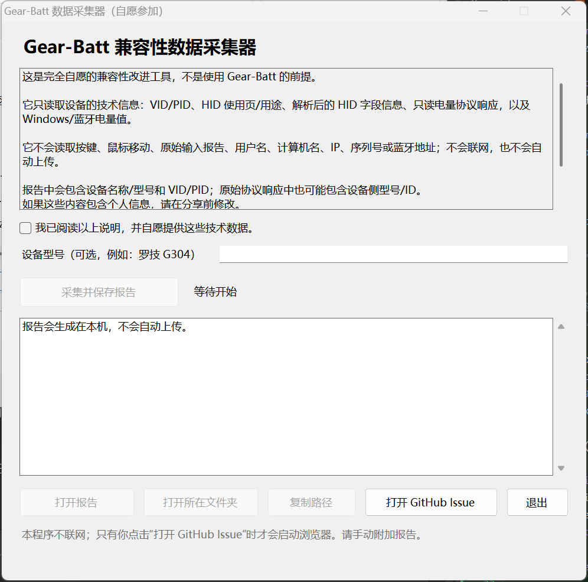
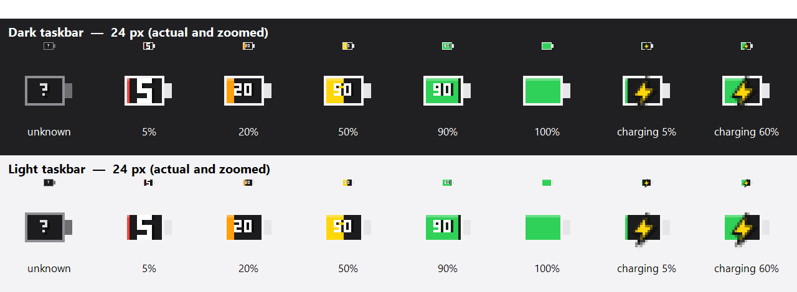

**中文** | [English](README.en.md)

# Gear-Batt

一个极简的 Windows 托盘小工具：读取无线外设（2.4G 接收器 / 蓝牙）的电量，在任务栏通知区域用一个电池图标显示。充电时显示闪电，使用电池时按比例填充，并在电池内显示百分比。


## 特性

- **单个 exe，无需安装**：使用 Windows 自带的 .NET Framework 4.8（Windows 10 1903+ / Windows 11 默认包含），不依赖第三方运行库。
- **枚举所有可读取电量的无线设备**：第一版同一时间只显示一个设备；检测到多个设备时，在菜单中指定要显示哪一个。
- **电池状态**：电池图标内部按电量比例填充；0–99% 在电池内显示百分比数字，100% 显示满格。
- **充电状态**：电池内显示黄色闪电，精确百分比在悬停提示和菜单中查看。
- **低电量颜色**：≤15% 红色，≤30% 橙色，≤55% 黄色，其余绿色。
- **精确信息**：悬停提示和左键菜单显示设备名、百分比、充电/电池状态、连接类型和最后更新时间。
- **状态即时刷新**：设备接入/移除、系统电源状态变化会立即触发扫描；充电或电量 ≤10% 时每 5 秒快速检查，其余时间 60 秒。
- **低电量提醒**：当前显示的设备未充电且电量低于 5% 时，静默弹出一次提示卡片；不播放声音、不抢焦点、不会自动关闭（点击右上角 × 关闭）。
- **记住选择**：设置保存在 `%LOCALAPPDATA%\Gear-Batt\settings.ini`，下次启动继续显示上次选择的设备。
- **开机启动**：当前用户登录时自动启动，无需管理员权限；会同时识别任务管理器“启动”页中的禁用状态。
- **低占用**：默认 60 秒刷新一次，扫描在后台线程进行，空闲时不轮询。
- **无网络访问**：主程序不上传任何设备信息。

## 帮助适配你的设备（完全自愿）

Gear-Batt 提供独立的数据采集器 `Gear-Batt-Collector.exe`，用于帮助后续适配更多 2.4G 设备。它不是使用 Gear-Batt 的前提，**完全自愿**。



使用方法：

1. 双击 `Gear-Batt-Collector.exe`。
2. 阅读窗口中的说明；只有勾选“我已阅读以上说明，并自愿提供这些技术数据”后，采集按钮才会启用。
3. 可选填写设备型号（例如“罗技 G304”），点击“采集并保存报告”。
4. 报告默认保存到桌面，文件名形如 `Gear-Batt-Report-YYYYMMDD-HHMMSS.txt`。
5. 先打开报告检查内容；确认没有问题后，再手动附加到 [GitHub Issue](https://github.com/dddsx3/Gear-Batt/issues/new)。

**采集内容**：操作系统版本、程序版本、HID 接口的 VID/PID、使用页/用途、报告长度、产品/制造商名称、解析后的 HID 字段信息、只读电量协议响应，以及 Windows/蓝牙电量值。

**不会采集**：按键、鼠标移动、原始输入报告、用户名、计算机名、IP 地址、USB 序列号、蓝牙地址；不会联网，也不会自动上传。实例路径中的序列号后缀会被脱敏。报告中会包含设备名称/型号和 VID/PID；原始协议响应（HID++/ATK/DARKRIM）中也可能包含设备侧的型号或 ID 字节。如果这些内容包含个人信息，请在分享前修改。

> 主程序的菜单里也有“帮助适配我的设备…”：如果同目录存在 `Gear-Batt-Collector.exe`，会直接启动它；否则会显示项目地址和说明。

## 支持的电量来源

Gear-Batt 采用分层读取，尽可能覆盖不同类型的无线设备：

1. **Windows 电池接口**
   适用于向 Windows 暴露 HID 电池设备的 2.4G 接收器 / 无线外设（部分罗技、微软、戴尔及其他品牌）。通过 `IOCTL_BATTERY_QUERY_INFORMATION` 读取容量与充电状态。

2. **罗技 HID++ 2.0**
   适用于罗技 Unifying / Bolt / Lightspeed 接收器以及直连 HID++ 设备。按 HID++ 2.0 规范读取：
   - `0x1000` Battery Status（电量/状态）
   - `0x1004` Unified Battery（电量/近似等级/状态）
   - `0x1001` Battery Voltage（电压，按曲线估算百分比并标记为近似）
   - `0x0005` Device Name（设备名）

3. **ATK / VXE 无线鼠标（373B:1216）**
   只读查询协议 2：usage page `0xFF05`，Report ID `0x08`，校验回复后读取电量。仅在 VID/PID/usage page/报告长度完全匹配时发送。

4. **DARKRIM 无线耳机（3654:6901）**
   只读查询杰理 JL_RCSP TLV 协议：usage page `0xFF02`、usage `0x0002`、65 字节帧、CRC16-CCITT-FALSE；只查询电量 TLV `0x01`，不发送 EQ/写入类命令。

5. **Windows 蓝牙电量属性**
   适用于向 Windows 报告电量的蓝牙鼠标、键盘、耳机等。会同时尝试蓝牙类枚举和全类枚举，以覆盖部分 Hands-Free/AG Audio 节点；属性值为 0 时按“未知/未连接”处理，而不是显示 0%。

> **关于 2.4G 的兼容性**：2.4G 并不是一种统一的上报标准。很多厂商（例如部分雷蛇、海盗船、赛睿产品以及低价鼠标）只在自己的驱动或私有协议中提供电量，不向 Windows 暴露。此类设备无法被通用程序读取，这不是 Gear-Batt 的 bug。
>
> 本机没有罗技 2.4G、ATK/VXE 或 DARKRIM 硬件；相关通道已实现并通过协议解析/CRC 自测，但尚未在真实设备上验证。可用 `--diag --verbose` 或采集器报告查看实际探测结果。

## 使用

1. 双击 `dist/Gear-Batt.exe`。
2. Windows 11 默认会把新托盘图标放进“隐藏的图标”浮层（任务栏的 `^`）。打开浮层后，把 Gear-Batt 图标拖到任务栏上、WiFi 图标旁边即可。
3. 左键单击图标打开设备菜单：
   - 检测到多个设备时，单击其中一个即可切换显示（第一版同一时间只显示一个设备）。
   - **立即刷新**：重新扫描。
   - **开机启动**：切换当前用户登录时自动启动。
   - **使用说明**：查看支持范围。
   - **帮助适配我的设备…**：启动自愿数据采集器，或查看项目地址。
   - **退出**：退出程序。
4. 鼠标悬停在图标上可查看精确电量、充电状态、连接类型和更新时间。

> Windows 不允许第三方程序把图标强制插到 WiFi 图标旁边；系统图标区域的位置由用户拖动决定。

## 低电量提醒

当前显示的设备未充电且电量低于 5% 时，会在屏幕右下角静默弹出一个提示卡片：

- 不播放声音
- 不抢焦点（使用 `WS_EX_NOACTIVATE`）
- 不会自动关闭；点击右上角 × 关闭，避免漏看
- 同一轮低电量只提醒一次；电量回升到 5% 或开始充电后重置
- 只针对当前显示的设备；充电中不打扰


## 图标说明

| 状态 | 显示 |
|---|---|
| 电池供电 | 电池外框 + 按比例填充 + 0–99 的百分比数字；100% 为满格 |
| 充电 | 电池 + 黄色闪电（精确百分比在悬停/菜单中） |
| 未检测到设备 | 灰色电池 + `?` |
| 低电量 | 红色 / 橙色填充 |



## 诊断

```bat
Gear-Batt.exe --diag --out diag.txt --verbose
```

报告包含：系统版本、进程位数、托盘图标尺寸、所有可读设备、原始百分比/充电状态、提供方、HID++/ATK/DARKRIM 探测日志和错误。

> `--diag` 报告包含设备实例 ID，可能包含蓝牙地址或 USB 序列号；请优先使用采集器生成的可分享报告，或在分享前脱敏。

采集器的命令行模式（适合开发/自动化，报告仍是本地文件）：

```bat
Gear-Batt-Collector.exe --collect --out report.txt --model "罗技 G304"
```

其他开发参数：

```bat
Gear-Batt.exe --selftest --out selftest.txt
Gear-Batt.exe --mock --select mock:g304
Gear-Batt.exe --render-icons preview
```

## 构建

要求：Windows 10 1903+ / Windows 11，系统自带 .NET Framework 4.8 的 C# 编译器（`%WINDIR%\Microsoft.NET\Framework64\v4.0.30319\csc.exe`）。不需要 Visual Studio、NuGet 或网络。

```bat
build.cmd
```

输出：

- `dist\Gear-Batt.exe`：主托盘程序（约 110 KB）
- `dist\Gear-Batt-Collector.exe`：自愿数据采集器（约 100 KB）

源码结构：

- `src/Program.cs`：主程序入口、诊断、自测、图标预览
- `src/TrayApp.cs`：托盘图标、菜单、单设备选择、定时刷新
- `src/IconRenderer.cs`：16/24/32/48 px 电池与闪电图标绘制
- `src/Providers.cs`：Windows 电池接口、蓝牙电量属性、设备去重与命名
- `src/Hidpp.cs`：罗技 HID++ 2.0 传输与电量解析
- `src/HidDevices.cs`：HID 接口枚举、解析后的 value caps
- `src/VendorProtocols.cs`：ATK/VXE 与 DARKRIM 只读协议
- `src/Native.cs`：SetupAPI / HID / 电池 IOCTL / CM P/Invoke
- `src/Settings.cs`：设置持久化与开机启动
- `src/Models.cs`：设备模型与文本工具
- `collector/`：独立的自愿数据采集器

## 与同类项目的差异

- **`yszyszysz233/2.4G-battery-viewer`**：一个只支持两台固定设备的 Python/ctypes 工具，价值在于逆向得到的 ATK/VXE 与 DARKRIM 协议、以及通用 HID 兜底思路。Gear-Batt 独立实现了这两条只读协议，并修正了自身 HID++ 2.0 的报文/特性映射；没有复制其代码（该仓库未提供许可证，且协议说明仅限学习/个人使用）。ATK/DARKRIM 协议事实的参考来源在此致谢。
- **CoderTools 在线 USB 设备查看器**（用户提供的网页工具）：基于 WebHID 的通用 VID/PID/HID 描述符查看器，不是电量读取器。它启发了采集器导出 HID 元数据；但 Windows 用户态 HID API 不提供原始报告描述符，所以 Gear-Batt 采集器改为记录解析后的 value caps（使用页/用途、Report ID、逻辑范围、位宽等），同样可用于适配。
- 相比两者，Gear-Batt 的优势是：单文件 exe、无需 Python/浏览器、托盘常驻、设备选择、开机启动、修正后的 HID++ 2.0、蓝牙支持和独立的自愿采集器。代价是：第一版仍只显示一个设备，且对不上报电量的私有协议设备无能为力。

## 已知限制

- 第一版只显示一个设备；多设备需要手动选择。
- 仅支持向 Windows、罗技 HID++、ATK/VXE、DARKRIM 或蓝牙电量属性上报电量的设备。
- HID++ 1.0、罗技私有加密通道、雷蛇/海盗船/赛睿等私有协议未实现。
- 如果 Logitech G HUB / Options+ 等厂商软件独占了 HID 接口，HID++ 读取可能失败；关闭厂商软件后重试。
- 标准 HID Battery Strength 的 Feature Report 兜底尚未加入主程序；Windows 电池接口已覆盖常见情况，采集器会记录解析后的 value caps，便于后续按真实数据补充。
- 原始 HID 报告描述符无法通过 Windows 用户态 HID API 获取；采集器记录的是解析后的字段信息。
- 托盘图标实际尺寸由系统 DPI 决定（100% 为 16 px，150% 为 24 px）。16 px 下精确数字较小，悬停/菜单始终显示完整百分比。
- 部分设备在充电时只报告“已接通电源”而不报告“正在充电”，此时可能不显示闪电；这是设备驱动行为。
- 低电量提醒只针对当前显示设备，且仅在未充电时触发；同一轮低电量只提醒一次，避免每 60 秒重复打扰；弹窗不会自动关闭，需要手动点击 ×。
- 需要 .NET Framework 4.8（Windows 10 1903+ / Windows 11 自带）。如果要在更老的系统上运行，需要改为自包含发布。

## 隐私

- 主程序不访问网络，不上传任何设备信息。设置仅保存在本机 `%LOCALAPPDATA%\Gear-Batt\settings.ini`。
- 采集器完全自愿，不联网、不自动上传；报告只保存在本机，由用户决定是否分享。采集器不会读取按键、鼠标移动、原始输入报告、用户名、计算机名、IP、序列号或蓝牙地址。
- 报告中包含设备名称/型号和 VID/PID；分享前请检查并修改任何你不想公开的内容。

## 版本

- **v1.3.0**：设备接入/移除与电源状态变化立即刷新；充电或电量 ≤10% 时每 5 秒快速检查；低电量弹窗不再自动关闭，需点击 × 关闭。
- **v1.2.0**：新增低电量提醒：当前显示设备未充电且低于 5% 时静默弹出提示卡片（无声音、不抢焦点、每轮一次）。
- **v1.1.0**：修正 HID++ 2.0 报文布局与 `0x1000/0x1004/0x1001` 解析；新增 ATK/VXE 373B:1216、DARKRIM 3654:6901 只读协议；增强蓝牙枚举与 0% 处理；开机启动识别 StartupApproved；60 秒刷新与更新时间；新增完全自愿的数据采集器。
- **v1.0.0**：首个 Windows 单文件版本；单设备托盘显示、Windows 电池接口、罗技 HID++ 2.0、蓝牙电量属性、开机启动、诊断/自测。
